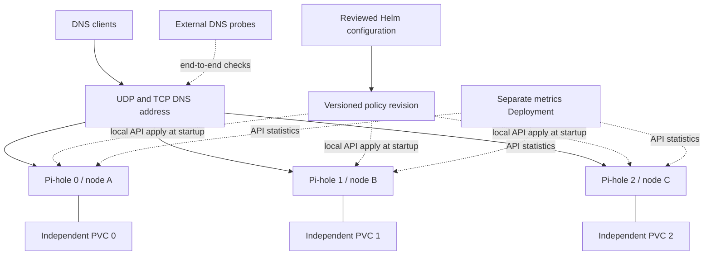

# Pi-hole chart v2 production architecture and execution plan

Status: v2.0.0 implementation with bounded DNS-profile validation, updated 2026-11-15. This is a portable chart; `deploy/staging` contains a separate homelab deployment profile. See the [runtime evidence and limits](validation/README.md). The original design/findings below are retained as architecture rationale; this status section records the implementation.

Reviewed repository commit: `3a588d36daaef61c1a0e32b53292d522ee22eea4` (chart `1.7.0`). The target is a portable Helm chart with a tested production DNS profile, predictable upgrades, and documented limits. Environment-specific networking and storage are certified through separate deployment profiles.

## Implementation status: 2.0.0

The generic DNS profile now has stable StatefulSet identity, independent retained claims, DNS-only selectors, explicit credentials and controlled rotation, coordinated high listener ports, local policy-aware DNS probes, reduced startup capabilities, private administration and an independent authenticated exporter. Native FTL values and Kubernetes Services are separate. Auxiliary DHCP/NTP services are outside DNS HA certification.

The API policy runner validates complete input before mutations, journals ownership and write-ahead intents, protects unmanaged dependencies, reconciles owned deletion, and retains immutable content-named artifacts. Optional production pinned-list mode verifies HTTPS bodies by SHA-256, caches them per PVC and uses local `file://` subscriptions. Scheduled checks share the runner lock; unchanged verified snapshots retain readiness and avoid redundant rebuilds. Rebuilds recover pending dirty state. Encrypted off-cluster backup/fresh-namespace restore preserves journal identity and filtering with the provider unavailable. TLS Secret mounting and positive/negative certificate checks are exercised.

Local fixtures cover amd64/Helm 3 and arm64/Helm 3/4; Kubernetes 1.35.8, 1.36.4 and 1.37.0; previous-image retained-data upgrades; policy/API failure and rollback; a synthetic 100,001-domain list; and external UDP/TCP failover after SIGKILL of a disposable kind announcer node. This is bounded software/profile evidence, not a chart-wide availability SLA or hardware/site certification. The retained Cilium/Talos profile supplies separate real-CNI and persistent-volume upgrade evidence. Consult each report for its exact tested state.

CI builds one reproducible archive and gates that archive through the 12-combination version/architecture matrix, blocking rendered-manifest and image scans, and the disposable HA/TLS/recovery fixture. A manual release workflow accepts only a successful complete main-push run, signs without repackaging and independently resumes GitHub, OCI and Pages publication. Real signature/OCI round trips and byte-mismatch rejection are tested locally. GitHub Actions and external publication still require execution after review/merge; local tests do not claim those remote systems ran.

Production deployment acceptance remains environment-specific: durable storage/quota and history sizing, source-IP preservation, CNI egress, actual load-balancer/failure topology, independent bootstrap/upstreams, continuous external/site probes, notification delivery and measured capacity after the selected failure. A custom Restricted runtime, IPv6/dual-stack certification, continuous policy control, autoscaling and DHCP lease failover remain outside this stable DNS scope.

See [migration instructions](../charts/pihole/MIGRATION.md), the [HA evaluation profile](../examples/values-ha.yaml), and [v2 runtime evidence](validation/v2-runtime.json). The defect table below describes the original reviewed baseline; the implementation status records which findings have been addressed.

## 1. Compatibility baseline

The application contract is the complete Docker release, including its entrypoint, embedded components, API, filesystem behavior, and scheduled tasks.

| Item | Verified baseline | Release requirement |
| --- | --- | --- |
| Image | `docker.io/pihole/pihole:2026.11.0` | Pin the multi-platform index digest as a separate value |
| Index digest | `sha256:66c798d79a95c2691f280329c3611dba1746117c61c9f331907ca35a06a52778` | Reverify when publishing the implementation |
| Embedded components | FTL `v6.9`, Core `v6.6`, Web `v6.6.1` | Check running versions against the compatibility record |
| Registry platforms | Linux amd64, arm64, arm/v6, arm/v7, 386, riscv64 | Initially certify amd64 and arm64; published image support alone does not certify chart support |
| Exporter | `ekofr/pihole-exporter:v1.3.1`, index `sha256:4233c06fcd2d62c37b9345228bc9f798b3a66d052b4955ec6a0e5b8825e20827` | Authenticated multi-target scrape and stale-data behavior tested on amd64; extend release coverage |
| Kubernetes | Proposed initial test matrix: supported 1.35, 1.36, 1.37 minors | Pin exact test versions; revisit support at each release |
| Helm | Explicitly selected maintained Helm 3 and Helm 4 versions | Test both or narrow the published compatibility claim |

Current component versions come from the [Docker release](https://github.com/pi-hole/docker-pi-hole/releases/tag/2026.11.0). Current digests and platforms were resolved directly through Docker Hub manifests; attestation entries with platform `unknown/unknown` are not runtime platforms. The proposed Kubernetes matrix follows the [upstream support schedule](https://kubernetes.io/releases/patch-releases/) as of the review date.

Keep `Chart.appVersion` as the human-readable Docker tag. Introduce `image.digest` and render `repository:tag@digest`. A custom tag or digest is an explicit compatibility override, not an implicit promise that all v6 images work. Renovate must update the tag, digest, component inventory, and compatibility tests together. Application updates require review and successful runtime gates; chart semver reflects resulting behavior changes.

## 2. Target architecture and availability boundary

The arrows from the DNS address represent eligible backends, not a guarantee of even distribution. The actual traffic path depends on the load balancer, CNI, source address, and UDP connection tracking.

Use a StatefulSet for every replica count. Pi-hole replicas are independent DNS servers: they share desired policy, but do not form a quorum or replicate query history, caches, sessions, or DHCP leases. Support two replicas on two nodes and recommend three on three nodes for production maintenance headroom. Capacity must remain sufficient after the chosen failure.

Use hard anti-affinity across node hostnames in the HA profile and optional zone spread. Prefer `podManagementPolicy: Parallel` for independent startup/recovery, paired with ordinary one-at-a-time rolling updates and a tested `minReadySeconds`. Keep optional update features outside the baseline. A PDB allowing one voluntary disruption must select only DNS pods; it does not control node failures or replace rollout controls. See [StatefulSet behavior](https://kubernetes.io/docs/concepts/workloads/controllers/statefulset/).

Retain a discovery-only headless Service with precise DNS-pod selectors. Consider `publishNotReadyAddresses: true` there for diagnostics and exporter discovery; validate this explicitly. Client DNS Services must continue to select only Ready backends. Do not use the discovery address as the advertised client resolver.

## 3. Networking, dependencies, and administration

- Expose TCP and UDP on the same DNS address. Keep split Services only for providers that require them, with tested shared-address configuration. Support provider annotations, `loadBalancerClass`, source ranges, and IP-family settings where applicable.
- Preserve client source addresses when client-specific policy is required. `externalTrafficPolicy: Local` is a profile decision, not a universal active-active guarantee.
- With MetalLB layer 2 plus `Local`, external traffic reaches only pods on the announcing node. Other replicas provide failover capacity. BGP/ECMP plus `Local`, where the network supports it, can distribute traffic across eligible nodes. `Cluster` can distribute traffic but may change the observed source IP. These are separate profiles with separate tests. See [MetalLB traffic policy behavior](https://metallb.io/usage/).
- Make pod `dnsPolicy` and `dnsConfig` configurable. Declare upstream DNS explicitly and prevent CoreDNS → Pi-hole → CoreDNS forwarding cycles. Test cold startup, image pulls, blocklist downloads, and total-restart recovery. The bootstrap resolver must remain available independently of this release.
- Treat the control plane, CNI, load balancer, storage, upstream resolvers, and client resolver behavior as dependencies of the availability claim. Add an independent release in another cluster/site for site-level resilience; distributing multiple DNS addresses still requires client-side failure tests.
- Keep administration private. Provide explicit per-instance endpoints or port-forward instructions so users know which instance they are inspecting. Pod-0 may remain a convenience endpoint with documented downtime. Balancing the web UI does not synchronize sessions, policy edits, or history. Any optional shared web endpoint needs sticky routing, reauthentication behavior, and tests.

The production DNS profile disables DHCP and NTP functionality in FTL, not just their Kubernetes Services. DHCP needs a separate, explicitly designed lease-coordination/failover solution; reject the ordinary shared-pool DHCP-plus-multiple-replicas combination.

## 4. Tag-specific settings and startup contract

Create a versioned configuration inventory from FTL v6.8 and the Docker entrypoint. Audit every advertised setting against it, including unset/null, false, zero, empty strings, and empty arrays. Separate native FTL configuration from chart Service settings in the v2 values API; the current mixed tree prevents a clean generic renderer.

Confirmed changes needed for this tag:

- Remove or reject `files.pid`: FTL v6.8 hardcodes that path. Add coverage for currently missing keys such as `dns.cache.rrtype`, `resolver.macNames`, `database.forceDisk`, `files.tmp_db`, and `misc.hide_connection_error`. Decide and document coverage of `debug.*`.
- Fix the current omission of `dns.localise: false` and `dns.domain.local: false`. Define explicit clearing semantics for persisted settings. Both semicolon-separated and newline-separated arrays are supported by this FTL release.
- Use internal DNS port 5353 and HTTP port 8080 in the proposed production profile, with Services exposing the normal client ports. The runtime experiment passed on 5353 with no-new-privileges and a privileged-port threshold of 1024; port 53 failed in that combination. Derive FTL settings, named container ports, Service targets, probes, NetworkPolicies, tests, and exporter targets from one listener model. This mapping remains to be implemented and tested end to end. Custom web listener strings need explicit mappings or validation rather than partial automatic interpretation.
- Require explicit production upstreams. This Docker release fills an empty effective upstream list with Google resolvers; standalone FTL defaults alone do not describe container behavior.
- Explicitly set `ntp.ipv4.active`, `ntp.ipv6.active`, and `ntp.sync.active` to false in the DNS profile, and choose a neutral `misc.nice` value. Disabling an NTP Service does not disable these functions.

Sources: [FTL v6.8 configuration registry](https://github.com/pi-hole/FTL/blob/v6.8/src/config/config.c), [environment parser](https://github.com/pi-hole/FTL/blob/v6.8/src/config/env.c), [Docker configuration functions](https://github.com/pi-hole/docker-pi-hole/blob/2026.10.0/src/bash_functions.sh).

The stock entrypoint performs database/gravity preparation before FTL starts. The runtime experiment also confirmed that gravity checks name resolution for `raw.githubusercontent.com` (then `github.com` on retry) even with an empty adlist file. Offline bootstrap needs a deliberate solution to that upstream check; merely removing subscriptions is insufficient. It then has its own 30-second wait for the FTL startup log marker. A Kubernetes startup probe can accommodate the earlier initialization work; it cannot extend that internal deadline. Preserve the upstream entrypoint and signal handling. See [tagged startup script](https://github.com/pi-hole/docker-pi-hole/blob/2026.10.0/src/start.sh) and [Core gravity script](https://github.com/pi-hole/pi-hole/blob/v6.5/gravity.sh).

Use a bounded local DNS probe with an asserted response code and expected local answer. Startup/readiness also require the current policy revision to have been applied. Liveness checks local process/DNS responsiveness, independently of public upstream availability. Public DNS and filtering correctness belong in synthetic monitoring. Do not treat a successful `dig` process exit or web-page response alone as DNS correctness.

## 5. Policy application and consistency

The baseline is a bounded local apply operation on pod startup, using FTL's supported API. Continuous reconciliation is optional future work with a separate failure contract.

1. Serialize desired groups, clients, list subscriptions, and domain rules as JSON data. Never insert user strings into executable shell fragments or SQL. Include subscription type (`allow` or `block`) and explicit group associations.
2. Bind each pod revision to an immutable, content-named policy ConfigMap. For production, manage these artifacts separately from the application Helm release: a small generator emits an explicit active-and-retained revision set in Git, applied before the workload; the chart references the selected existing ConfigMap and revision. This lets Helm rollback change the workload without pruning policy artifacts that newer pods still need. Retain revisions referenced by live pods, controller revisions, and the supported rollback window. Test Helm rollback and GitOps pruning, then garbage-collect only after those references expire. A convenience chart-managed mode needs separate retention tests and cannot inherit this guarantee automatically.
3. Invoke a bounded `postStart` apply runner against loopback after FTL's API becomes available. Its total deadline starts at invocation and includes waiting for initial gravity/bootstrap and API availability. Define this cold-start budget separately from FTL's internal 30-second startup deadline. This preserves the stock entrypoint. It must not wait on a Ready-gated Service to reach itself. Investigate the local CLI credential already used by Core, avoiding a new permanent admin credential where supported.
4. Prevalidate input, resolve group IDs on each replica, and apply groups before associations. Preserve built-in group ID 0 (`Default`); database triggers can attach new entries to it, so explicitly reconcile associations rather than assuming omission removes them. Track owned records by stable identity and a persistent ownership journal. Remove only previously owned records absent from the new desired policy. In explicit bootstrap/migration mode, define adoption/removal of the image-created default adlist and preserve unrelated user data.
5. For a new or changed policy, run any required tag-supported gravity update and verify completion. For a restart with the same desired revision, validate the persistent ownership/applied-revision record and usable local gravity data; allow recovery without requiring a successful remote list refresh when the existing policy is valid. Bound API retries and total apply duration. Clear prior readiness state on every container start and write an atomic readiness marker only after validating this startup attempt: an `emptyDir` survives container restarts. Log out API sessions and handle credentials becoming stale if FTL restarts. Logs must omit credentials and sensitive client data.
6. Keep the pod out of client DNS traffic until the current revision and local DNS checks pass. API operations across multiple endpoints are not an atomic transaction: test interruption at each stage, restart, idempotent repair, and failed rollback.

FTL v6.8 has the needed policy APIs: [lists](https://github.com/pi-hole/FTL/blob/v6.8/src/api/docs/content/specs/lists.yaml), [groups](https://github.com/pi-hole/FTL/blob/v6.8/src/api/docs/content/specs/groups.yaml), and [clients](https://github.com/pi-hole/FTL/blob/v6.8/src/api/docs/content/specs/clients.yaml). Core's [API helper](https://github.com/pi-hole/pi-hole/blob/v6.5/advanced/Scripts/api.sh) provides the local credential precedent; the [database schema](https://github.com/pi-hole/pi-hole/blob/v6.5/advanced/Templates/gravity.db.sql) defines group-0 behavior. The runner still requires a runtime proof with the exact image. Test actual kubelet hook/probe ordering and enforce the deadline in the runner itself; a startup probe is not a substitute for a bounded hook.

Fresh-image initialization can download its initial list before the local API is available. Test this cold-start path; a readiness check cannot undo traffic already sent during bootstrap. An offline or approved-sources-only profile must supply tested preseeded input or another tag-compatible startup integration.

FTL configuration made read-only does not make list/group/client APIs read-only. The baseline operational contract forbids direct production policy edits, detects divergence with a separate scheduled audit, and reapplies through controlled rollouts. Any break-glass edits must be reconciled back to Git. Automatic periodic enforcement is an explicit later feature, with rollout and last-good-state semantics.

Declare two content-consistency profiles:

| Profile | Contract |
| --- | --- |
| Standard | Same desired subscription/rule configuration; independently downloaded lists may differ temporarily. Monitor freshness and policy differences. |
| Controlled snapshots, recommended for reproducible production | Serve reviewed list content at immutable versioned URLs from an approved mirror/object store; promote the same snapshot through a controlled rollout. Keep large list bodies out of ConfigMaps. |

The image runs its own randomized gravity schedule. Account for it before introducing another scheduler, and verify serialization with the startup apply operation. Immutable list sources make refresh content repeatable but do not create a globally atomic policy cutover: old and new revisions coexist during rolling updates. Requirements for instantaneous policy revocation need a separate coordinated cutover design. See the [tagged crontab](https://github.com/pi-hole/docker-pi-hole/blob/2026.10.0/src/crontab.txt).

Later download failures should preserve an already usable policy and raise staleness alerts. A fresh replica with no usable policy must remain unready; recovering old instances and creating new ones are different scenarios.

## 6. Security and credentials

Certify a stock-image compatibility profile first. The upstream startup path performs root-owned setup, ownership changes, and capability handling before dropping to the Pi-hole user. The amd64 experiments passed with no-new-privileges and a reduced capability candidate, but failed with non-root startup or the tested read-only-root mounts. With no-new-privileges, the running FTL process had no effective capabilities; low-port binding depended on the network namespace's unprivileged-port threshold. The tested kind runtime used threshold 0, while an explicit threshold of 1024 broke DNS port 53. Higher internal listener ports address that binding dependency but do not make startup Restricted/non-root compatible. Sources: [runtime report](validation/README.md), [Docker startup](https://github.com/pi-hole/docker-pi-hole/blob/2026.10.0/src/start.sh), [Core prestart](https://github.com/pi-hole/pi-hole/blob/v6.5/advanced/Templates/pihole-FTL-prestart.sh), [FTL capabilities](https://github.com/pi-hole/FTL/blob/v6.8/src/capabilities.c).

Measure the minimum working capability set. Keep host networking off and avoid DHCP/time-setting/elevated-priority capabilities in the DNS profile. A Restricted profile may require a maintained alternative bootstrap/image and belongs behind an explicit feasibility gate, with its additional maintenance cost documented.

Production uses an existing, versioned Secret or external Secret management. Eliminate random credentials from deterministic rendering and stop printing supplied passwords in Helm NOTES. Define rolling credential rotation for both Pi-hole and the exporter; projected Secret files do not imply that the application reloads them. Disable ServiceAccount token mounting and use release-scoped accounts.

Provide protocol-aware ingress and egress policies with declared DNS client CIDRs, admin/monitoring selectors, upstreams, and list retrieval routes. Validate their behavior on a real CNI and with the chosen load-balancer source translation. Standard NetworkPolicy does not provide portable hostname-based egress filtering: use an explicit egress proxy, fixed destinations, or a documented CNI-specific profile for dynamic list hosts. See [Kubernetes NetworkPolicy](https://kubernetes.io/docs/concepts/services-networking/network-policies/).

Use application credentials with reduced privileges where supported, but do not label `app_sudo: false` as a read-only monitoring role. Treat Teleporter archives as sensitive: they can include authentication material, and import is broad unless explicitly selected. Use encrypted, access-controlled backup storage and tag-tested restore selections. See [FTL Teleporter implementation](https://github.com/pi-hole/FTL/blob/v6.8/src/api/teleporter.c).

## 7. Observability, capacity, and recovery

Keep the exporter in a separate Deployment with its own probes, resources, scheduling, annotations, and credentials. A failed regular sidecar can make the entire pod unready, withdrawing healthy DNS. The same concern applies to an always-running configuration sidecar.

Exporter v1.3.0 supports Pi-hole v6, but requires these integration changes:

- Remove obsolete `INTERVAL` and `PIHOLE_API_TOKEN`/`setupVars.conf` examples. Collection occurs on scrape; use the supported password/password-file configuration.
- Use its supported HTTP health endpoints or binary healthcheck; its image has no shell or `wget`.
- Configure scrape/request timeouts using measured behavior. This version has a fixed overall collection deadline and may serve previous gauges after a target failure. `up == 1` proves HTTP reachability, not fresh Pi-hole statistics.
- Restart the exporter on password-file rotation; it reads that file during startup. Test reauthentication after FTL restarts.
- Start with one independent multi-target exporter. If monitoring redundancy is required, specify sharding/deduplication; duplicate exporters must not double dashboard totals.

Sources: [exporter v1.3.0 configuration](https://github.com/eko/pihole-exporter/blob/v1.3.0/config/configuration.go), [server](https://github.com/eko/pihole-exporter/blob/v1.3.0/internal/server/server.go), [API client](https://github.com/eko/pihole-exporter/blob/v1.3.0/internal/pihole/api_client.go), [image and healthcheck documentation](https://github.com/eko/pihole-exporter/blob/v1.3.0/README.md).

Probe each replica and the external DNS address over UDP and TCP. Verify local resolution, upstream resolution, expected allow/block behavior, client-specific rules, and response latency separately. Alert on insufficient serving capacity, wrong/stale policy, refresh failures, OOM/restarts, PVC/ephemeral-storage pressure, and exporter collection failures. Add collection-success/freshness telemetry through a verified exporter enhancement if the existing metrics cannot establish it.

Benchmark at declared list sizes, client/QPS levels, cache behavior, and history retention. Include CPU throttling, RSS, `/dev/shm`, temporary gravity storage, PVC growth, startup import time, and shutdown duration. The existing 256Mi limit and 500Mi claim are unverified production sizing assumptions. Do not enable autoscaling until cold-start time, policy readiness, capacity, and PVC lifecycle are proven.

Retain independent claims on scale-down/deletion unless an operator explicitly chooses disposal. Support storage-class selection, including explicit empty class semantics; document zone/node constraints. StatefulSet claim-template changes are not ordinary Helm updates: expanding existing PVCs requires a supporting StorageClass and an explicit procedure, while template reconciliation, StorageClass changes, and access-mode changes need a tested controller-recreation or parallel-release migration path. Never share writable Pi-hole databases between replicas.

Define separate recovery objectives for declarative configuration, credentials, and optional query history. Use supported application exports or consistent database backups/snapshots with a documented consistency procedure; do not copy live SQLite files casually. Test rebuild into a new namespace and restoration of a single lost claim. Application schema changes may require restoring a backup rather than `helm rollback`.

## 8. Confirmed repository defects to cover

| Priority | Evidence in the reviewed chart | Required regression |
| --- | --- | --- |
| P0 | Broad labels in `_helpers.tpl` also match metrics/test pods; headless ports are numeric | EndpointSlices and PDB membership contain only intended DNS pods, even during Helm tests |
| P0 | `secret.yaml` generates a new password on each render without a corresponding consumer rollout | Repeat renders are identical; credential rotation is deliberate and tested |
| P0 | Replica threshold changes resource kind and stops rendering the old standalone PVC | Existing-install migration protects the original claim and data |
| P0 | `configmap-lists.yaml` interpolates shell/SQL, waits indefinitely, and ignores gravity failure | Quotes/metacharacters are data; deadlines, failure propagation, updates and deletions work |
| P1 | DNS/web NodePort with omitted nested nodePorts maps fails to render | Every advertised Service type works with assigned or explicit ports |
| P1 | False/empty values and configurable listener ports are inconsistent | Tag-specific environment and end-to-end port contract tests |
| P1 | Default values install example domain rules and an allow-regex | Examples move out of live defaults; initial policy ownership is explicit |
| P1 | Shared ServiceAccount name; NetworkPolicy hardcoded/missing ports; no configurable bootstrap DNS | Multiple releases coexist and each networking/security profile is exercised |
| P1 | Exporter auth is not wired by default; legacy token/interval guidance remains | Authenticated multi-instance scraping and credential rotation work |
| P1 | Release validation depends on changed-chart detection against main | Exact release SHA always runs required chart tests |
| P1 | Trivy is informational and image updates can automerge without compatibility evidence | Actionable security and compatibility gates participate in release promotion |

The NodePort, boolean, listener, credential-rendering, and selector findings were checked through local source/render inspection. The table describes the reviewed baseline, not fixes already applied.

## 9. Execution sequence and release gates

| Change | Deliverables | Completion gate |
| --- | --- | --- |
| 0. Compatibility proof | Machine-readable tag/digest/component record; image startup/API/exporter fixtures; security and bootstrap spike | Exact-image cold start, policy apply and authenticated export succeed on amd64/arm64 with the proposed security context |
| 1. Correctness foundation | Component selectors, safe optional maps, credentials, environment semantics, sample-default cleanup, schema tests | Deterministic render matrix and live Service/PDB selection tests pass |
| 2. Stable v2 values/workload | StatefulSet-only model, separate FTL/Service settings, coherent ports, discovery, spread/PDB, claims, DNS bootstrap | Scaling/restart/drain tests pass without resource-kind changes or unintended claim deletion |
| 3. Policy lifecycle | Structured API runner, revision artifacts/retention, ownership journal, readiness, gravity coordination, consistency profiles | Fresh/adopted databases, edit/delete/reassignment, interrupted apply, unavailable providers, rollout and rollback fixtures pass |
| 4. Security and networking | Tested stock-image context, Secrets/rotation, network profiles, private administration, image digests | Real admission/CNI and external UDP/TCP/source-IP tests pass; exceptions are documented |
| 5. Operations and recovery | Independent exporter, synthetic probes, alerts, capacity results, backup/restore and runbooks | Failure/staleness detection, secret rotation and fresh-namespace restore demonstrated |
| 6. Release certification | Version matrix, prior-release migration, fault tests, supply-chain checks, signed artifacts and support docs | Required checks pass for the exact source SHA and image digests being published |

Add tests with each change. Phase 0 is a go/no-go point: failure of the stock-image/security or policy-API proof changes the design before the chart is rebuilt. Use backward-compatible 1.x patches only where safe; immutable selector changes, new values, and workload/storage migration belong to v2.

CI must validate the actual release SHA even when `ct list-changed` is empty. Changes to workflows, examples, compatibility data, and test harnesses must trigger relevant validation. Keep deterministic local DNS/list fixtures separate from internet-dependent integration checks. Test rendered manifests against the supported API versions, and run required image and manifest security scans with documented exceptions rather than an unconditional success exit.

Build/package once, publish the tested bytes, and verify signatures/provenance for both Helm-repository and OCI distribution. Make publication resumable per destination: an existing release tag must not cause a missing OCI artifact to be skipped after partial failure. Verify the digest/signature of existing artifacts, publish only missing destinations, and stop on mismatching published bytes. Pin tooling and CI actions; resolve digests for test/helper images too. Dependency changes must not bypass the same release gates.

Minimum runtime acceptance scenarios:

- Fresh install and empty-PVC restart; startup with blocked list downloads; restart with a large history database.
- Continuous external UDP/TCP queries during graceful pod replacement, rolling upgrade, node drain, and abrupt node/LB failure; record failures and time to recovery.
- Old/new policy coexistence during rollout, incorrect input, interrupted API apply, concurrent scheduled refresh, and last-good-policy behavior.
- Exporter crash, bad credentials, stale gauges, Secret rotation, unavailable upstream, and loss of a storage node/zone.
- Backup restoration, failed image upgrade, and previous-version chart migration with data assertions.
- Two releases in one namespace; Helm tests active while serving traffic; supported single-stack and any advertised dual-stack profiles.

Define DNS availability, response-time, policy freshness, and restoration objectives before certification. Publish measured results and the tested dependency topology. Graceful pod deletion alone does not prove hard-failure recovery, and zero packet loss is not a blanket chart guarantee.

## 10. Migration and implementation boundaries

For existing users, prefer a parallel v2 release with separate claims and a controlled DNS-address cutover. Back up the original installation, protect its PVCs, import/adopt policy explicitly, validate the new release under load, then change client routing. Keep the old installation and backups for a defined rollback window. Reusing a VIP requires a provider-specific handoff procedure; do not let two releases contend for it.

An in-place path, if offered, needs a separate tested procedure for the old Deployment, immutable selectors, claims, and Helm's deletion behavior. Increasing `replicas` on the current release is not that migration procedure.

Deferred features are a Restricted custom runtime, continuous API reconciliation, autoscaling, and coordinated DHCP HA. Each adds a distinct support and failure model. They can be introduced after the baseline gates establish a reliable DNS service.

The follow-up used Docker 28.4.0 on linux/amd64 and an isolated one-node kind Kubernetes 1.37.0 cluster. It tested startup/security candidates, policy API mutations, local UDP/TCP filtering, persisted restart without a list provider, exporter failure behavior, and live chart selectors. The [runtime report](validation/README.md) separates completed observations from remaining gates. Multi-node failures, load balancers, production storage, arm64, other supported versions, and the complete proposed policy runner still require certification.

On 2026-11-14, the v2 alpha was also deployed to retained [homelab staging](../deploy/staging/README.md). Eight live checks passed across two DNS nodes, with independent Talos directory-backed local PVs, real Cilium ingress/egress enforcement, workstation UDP/TCP NodePort queries, sequential pod replacement, versioned Secret rotation and Prometheus scraping/rule evaluation. This establishes a staging baseline for the next policy-lifecycle work. It does not certify node power-loss recovery, a production DNS VIP, storage backup restoration, synthetic availability monitoring or notification delivery. Directory-backed PVs share the host filesystem and do not enforce their declared capacity; production capacity isolation remains an explicit gate.

The alpha.3 dependency refresh keeps the validated lifecycle architecture and resolves the upstream/stashed v2 conflicts. Official tag comparisons show unchanged group/client/domain/list API specifications from FTL 6.8 to 6.9 and no added/removed configuration keys in the reviewed registry. Startup/config handling and Core privilege tooling changed, so the new images are exercised rather than inheriting the prior runtime certification. The updated workflow remains unconditional for the exact chart and uses the newer pinned actions and Helm 4.3.2.
